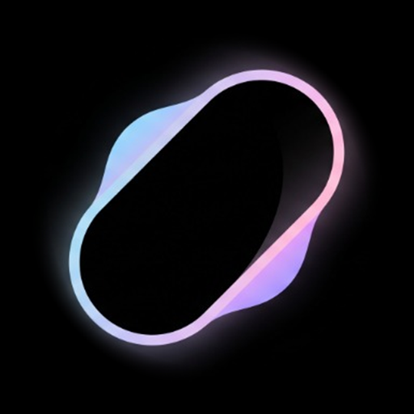
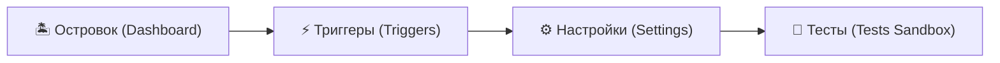
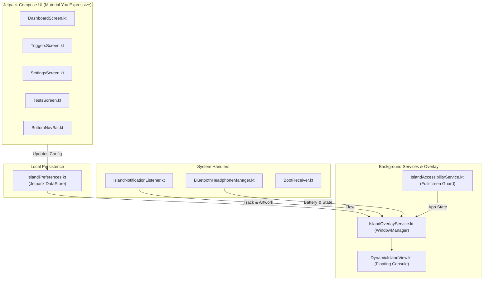

# 🏝️ DroidIsland: Dynamic Island & Camera Cutout Expansion for Android

<p align="center">
  
</p>

<p align="center">
  <strong>An organic, fluid dynamic island overlay for Android camera cutouts in a refined Google Pixel / Material You Expressive Dark OLED aesthetic.</strong>
</p>

<p align="center">
  <a href="https://github.com/miory-cane/DroidIsland/actions"></a>
  <a href="https://android.com"></a>
  <a href="https://kotlinlang.org"></a>
  <a href="https://developer.android.com/jetpack/compose"></a>
  <a href="LICENSE"></a>
  <a href="PRIVACY_POLICY.md"></a>
  <a href="https://boosty.to/droidisland_miory"></a>
</p>

<p align="center">
  <a href="https://github.com/miory-cane/droidisland/releases/latest/download/app-release.apk">
    
  </a>
</p>

---

## 📥 Скачать приложение / Download APK

- 🚀 **[Ссылка на скачивание готового APK (Google Drive)](https://drive.google.com/file/d/16On-QZez1SmGpZOxPcuw31WzMKOQvJf6/view?usp=drivesdk)**
---

## 🌟 Overview

**DroidIsland** turns your Android smartphone's camera punch-hole cutout into a fluid, responsive, and elegant interactive dynamic island. 

In its idle state, the island is completely disguised inside the camera cutout, taking zero extra screen space. When an event occurs—such as music playback, connecting Bluetooth headphones, or plugging in a charger—the capsule organically springs out from behind the camera lens using high-fidelity physics animations.

The companion app is built using **Jetpack Compose** with a dark, high-contrast **Google Pixel (Material You Expressive)** design language, optimized for true OLED blacks (`#0B0E14`), pastel accent tones, and tactile haptic feedback.

---

## ✨ Key Features

### 👁️ Camera Absorption & Expansion
- **Zero Double-Hole Glitch:** The island utilizes a 100% OLED black mask at its top boundary that seamlessly absorbs the physical camera cutout without drawing artificial rings over your lens.
- **Organic Spring Physics:** Expanding and collapsing transitions are powered by Jetpack Compose Spring physics (`dampingRatio = Spring.DampingRatioMediumBouncy`, `stiffness = Spring.StiffnessMediumLow`).
- **Conic Sweep Gradient & Ambient Glow:** Subtle glowing contours and ambient backlight during active events.

### 🎵 Dynamic Media Player
- **NotificationListener Integration:** Reads active media sessions from Spotify, YouTube Music, Apple Music, and other audio players.
- **Dynamic Palette Extraction:** Extracts primary and secondary accent colors from live album art via Android Palette.
- **Bouncing Bass Visualizer:** Animated equalizer bars reacting to playback state.
- **Squiggly Wave Slider:** Playback progress bar with animated expressive squiggly waves.
- **Interactive Controls:** Tap for Play/Pause, Next, Previous, and launch music app directly from the island.

### 🎧 Fast Pair Bluetooth Popups (TWS & Over-Ear)
- **True Wireless Stereo (TWS) Cards:** Popups for AirPods, Pixel Buds, Galaxy Buds with independent battery percentages for Left Earbud, Right Earbud, and Charging Case.
- **Over-Ear Headphone Cards:** Dedicated graphics and battery readout for over-ear headphones (Sony WH-1000XM, AirPods Max).
- **Interactive ANC Switcher:** Switch between Active Noise Cancellation, Transparency, and Off directly on the island.

### 🔋 Battery & Charging HUD
- **Instant Charge Pulse:** Elegant dynamic pill appearing upon charger connection.
- **Live Battery Percentage:** Green bolt indicator with real-time battery level.

### 🔕 Sound Profile Indicator
- **Instant HUD:** Visual feedback when switching between Silent (DND), Vibrate, and Normal sound profiles.

---

## 📱 Application Screens

The companion app features a clean 4-tab navigation structure:



1. **Островок (Dashboard):** Service status monitoring (Active/Inactive), live interactive preview of the dynamic island, quick action toggles for overlay and accessibility permissions.
2. **Триггеры (Triggers):** Individual controls for event modules:
   - Music Player module (album art, visualizer, track timeout);
   - Bluetooth Headphone module (connection popups, battery telemetry);
   - Sound Profile module (volume and ringer toasts).
3. **Настройки (Calibration Settings):**
   - **Quick Presets:** Center Punch-Hole, Left Punch-Hole, Dual Pill Cutout, Right Punch-Hole.
   - **Fine-Tuning Sliders:** X Offset, Y Offset, Camera Hole Diameter, Expanded Width (up to 600 dp), Expanded Height, Opacity, and Height Multiplier.
   - **Interactive Calibration Crosshair:** Visual guides to align the island precisely with your hardware lens within 0.5 mm.
4. **Тесты (Tests Sandbox):** An interactive playground to preview all island states on demand (Music Track, TWS Earbuds, Over-Ear Headphones, Battery Charging, Sound Profiles).

---

## 🏗️ Architecture



---

## 🚀 Building & Running

### Requirements
- **JDK 17** (Temurin, Corretto, or Android Studio JBR).
- **Android SDK:** Compile SDK 34, Target SDK 34, Minimum SDK 26 (Android 8.0+).
- **Build Tool:** Gradle Wrapper 8.9 with Android Gradle Plugin 8.5.2.

### CLI Build Commands
```powershell
# Clone the repository
git clone https://github.com/miory-cane/DroidIsland.git
cd DroidIsland

# Set JAVA_HOME if not configured globally
$env:JAVA_HOME = "C:\Program Files\Android\Android Studio\jbr"

# Build Debug APK
.\gradlew assembleDebug

# Build Release APK and Google Play App Bundle (AAB) with R8
.\gradlew assembleRelease bundleRelease
```

Generated outputs:
- **Debug APK:** `app/build/outputs/apk/debug/app-debug.apk`
- **Release APK:** `app/build/outputs/apk/release/app-release.apk`
- **Release AAB (Play Store):** `app/build/outputs/bundle/release/app-release.aab`

---

## 🔒 Privacy & Permissions

DroidIsland is engineered with a strict **Privacy-First** architecture:
- 🚫 **No Analytics or Telemetry:** No Firebase, no third-party tracking, no advertising SDKs.
- 📶 **100% Offline:** The app does not declare internet communication endpoints and never sends data externally.
- 💾 **Local Data Only:** All settings and calibration parameters are stored locally on-device in Jetpack DataStore and wiped upon uninstall.

See [PRIVACY_POLICY.md](PRIVACY_POLICY.md) and [PLAY_STORE_METADATA.md](PLAY_STORE_METADATA.md) for full compliance disclosures.

---

## 💖 Поддержка проекта / Support

Если вам нравится **DroidIsland** и вы хотите поддержать дальнейшую разработку новых модулей и анимаций:

👉 **[Поддержать автора на Boosty (boosty.to/droidisland_miory)](https://boosty.to/droidisland_miory)**

Ваша поддержка помогает тестировать приложение на новых устройствах и регулярно выпускать обновления!

---

## 🤝 Contributing

Contributions are welcome! Please check [CONTRIBUTING.md](CONTRIBUTING.md) for details on code style and pull requests.

---

## 📄 License

DroidIsland is open-source software licensed under the **[MIT License](LICENSE)**.
